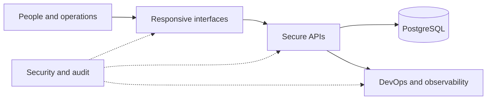
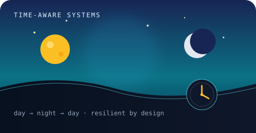
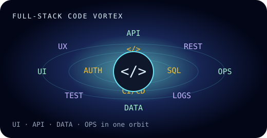
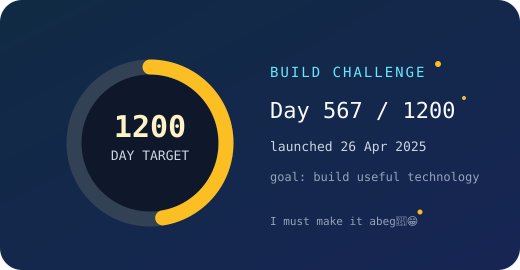

# Joe Maina

### Software Engineer · Cybersecurity Specialist · Ethical Hacker · Systems Auditor · DevOps

I build practical digital products and secure systems—from responsive interfaces and APIs to data-backed platforms, infrastructure, security controls, and audit-ready operations.

  
  
  
  
  

## Terminal signal

  

Turning real operational problems into secure, maintainable systems.

## About

I am a software engineer and cybersecurity specialist focused on turning real operational needs into maintainable, secure technology. My work spans full-stack development, backend and API design, systems engineering, ethical hacking, system auditing, security-minded delivery, and practical automation.

I enjoy moving across the stack: understanding the problem, shaping the architecture, implementing the interface and services, testing and hardening the system, auditing controls, and making the result useful for the people who depend on it.

## What I build

- **Full-stack products:** responsive web applications, dashboards, content systems, and business workflows.
- **Backend and APIs:** typed service layers, REST APIs, validation, authentication flows, data access, and integrations.
- **Cybersecurity and assurance:** authorized ethical-hacking practice, security testing, vulnerability awareness, secure coding, system auditing, access-control reviews, threat-aware design, and audit-minded controls.
- **Delivery and operations:** Linux environments, deployments, containerized workflows, observability, reliability, and DevOps practices.
- **Developer experience:** clear documentation, reusable components, maintainable code, and fast feedback loops—including responsible use of AI-assisted “vibe coding” with human review.

## Portfolio focus

Cosynco Solutions is one current product in a wider portfolio of 40+ projects, prototypes, internal systems, security exercises, visual experiments, and system blueprints. Some work is private, client-facing, or still being refined, so this profile highlights the engineering themes and outcomes without pretending every build is a public repository.

### Cosynco Solutions website — one current build

I am building and maintaining the Cosynco Solutions web platform, a production-oriented TanStack Start application with:

- React, TypeScript, TanStack Router, and server-side rendering on Node.js
- Tailwind CSS and accessible responsive UI patterns
- PostgreSQL-backed content and contact workflows
- Security middleware, CSRF protection, security headers, throttling, structured logging, and resilience checks
- Internationalized content, analytics, SEO metadata, sitemap generation, and a protected content-admin area

Explore the live work at [tech.wesharewithlove.org](https://tech.wesharewithlove.org/).

### CodeForge

The workspace also contains a separate learning-platform project with a React/Vite frontend and a Django/Python/PostgreSQL backend, covering API-driven application design, authentication, data modeling, and a practical developer workflow.

### Broader project portfolio

- **Business and operations:** school management, library management, attendance, point of sale, inventory, hotel management, booking, payroll, HR, CRM, ERP, rental management, property management, fleet management, church management, business dashboards, and workflow automation.
- **Healthcare and records:** hospital management, pharmacy management, health-suite platforms, patient and records workflows, reporting dashboards, and data-backed administrative tools.
- **Security and infrastructure:** API-security systems, secure API design, cybersecurity labs, authorized ethical-hacking exercises, vulnerability-assessment workflows, system-audit tooling, network-security practice, Linux hardening, access-control reviews, and incident-aware operations.
- **Developer platforms and services:** CodeForge, API experiments, authentication services, role-based access control, database-backed services, integrations, automation scripts, DevOps pipelines, GitHub workflows, and deployment tooling.
- **Frontend and visual engineering:** responsive business websites, landing pages, admin interfaces, portfolio experiences, JavaScript animations, time-aware interfaces, data-waterfall visualizations, security simulations, code-vortex scenes, and interactive UI experiments.

This breadth reflects how I work: I can take a problem from discovery and system design through manual coding, responsible AI-assisted development, security review, deployment, documentation, and ongoing improvement.

## Project atlas

My Codex work history covers 40+ builds, iterations, and project workstreams. Representative systems include:

- **PalsFund:** a group-savings and personal-savings platform with group withdrawals, approval workflows, reporting, PostgreSQL migrations, cPanel deployment, and an Android release package.
- **GOK Hotels System:** a role-aware hotel operations portal with staff workflows, collections, responsive dashboards, theme modes, and deployment verification.
- **Wanjema Cyber:** a Kenyan digital-service-centre experience with a destination gateway, cyber-services pages, training content, Knowledge Centre resources, portfolio galleries, and responsive visual design.
- **Company Hub Pro:** an internal operations platform covering employees, role and privilege management, purchase requests/LPOs, inventory links, approvals, messaging, email notifications, 2FA, activity history, and device/privacy workflows.
- **Raigways Tyres ERP:** inventory, point of sale, suppliers, purchases, reports, barcode workflows, M-Pesa/cash/bank payment handling, persistent data, staff approvals, and configurable privileges.
- **Kingdom Connect / Church Management:** a church-management system explored across React and Flask/Jinja implementations, with role-aware dashboards and deployment-safe startup workflows.
- **ISP Billing:** customer and admin portals connected to real PPPoE/MikroTik data, live connection status, router monitoring, usage visibility, alerts, and operational synchronization.
- **Library Management:** a React/Vite and Express/Prisma learning-library experience with authentication, dashboard data, responsive UI, and catalogue-oriented workflows.
- **Booking Management:** booking workflows with auditor and customer roles, dashboard interfaces, access controls, and operational reporting.
- **Automation and security work:** WhatsApp bot deployment and multi-account research, API-security systems, application-security reviews, ethical-hacking exercises, system-audit work, and secure deployment preparation.

These are alongside the live [Cosynco Solutions blueprint portfolio](https://tech.wesharewithlove.org/portfolio), which currently presents sixteen adaptable systems across education, healthcare, retail, hospitality, HR, faith organisations, property, sales, enterprise operations, transport, and services.

## Product and system blueprints

My portfolio documents a broad set of system blueprints and project builds. They are grouped here as examples of the business problems I design software around—not as unsupported claims that every deployment is publicly available.

- **Education:** School Management, Library Management, Attendance System
- **Healthcare:** Hospital Management, Pharmacy Management
- **Retail and hospitality:** Point of Sale, Inventory Management, Hotel Management, Booking System
- **People and operations:** Payroll Management, HR Management, CRM, ERP
- **Property and logistics:** Rental & Property Management, Fleet Management
- **Community:** Church Management

Across these systems, the recurring engineering themes are role-based workflows, records and reporting, payments or billing, auditability, responsive interfaces, API-driven services, PostgreSQL data models, and secure operational handover.

## Technology toolbox

  
  
  
  
  
  
  
  
  
  
  
  
  
  

**Languages and foundations:** Python, JavaScript, TypeScript, Java, C, C++, C#, PHP, Go, Rust, HTML, CSS, SQL, Bash.

**Cybersecurity and engineering:** cybersecurity fundamentals, authorized ethical hacking, application security, API security, vulnerability assessment, security testing, Linux administration, system auditing, network fundamentals, access controls, hardening, testing, documentation, and incident-aware thinking.

## GitHub at a glance

  
  

  

The panels above are live views of public GitHub activity and may change as the account grows.

## Architecture lens

The goal is a clear path from user need to dependable software: usable interfaces, explicit contracts, protected data, and observable delivery.

## Visual lab

These original, self-hosted SVG scenes turn the engineering themes into small visual stories. They are decorative portfolio samples—not claims of live product telemetry.

<table>
  <tr>
    <td width="50%" valign="top">
      
      
<strong>Time-aware systems</strong> Designed for workflows that keep working as the day, users, and operating conditions change.

    </td>
    <td width="50%" valign="top">
      
      
<strong>Data waterfall</strong> A visual metaphor for events, APIs, records, logs, and dependable responses.

    </td>
  </tr>
  <tr>
    <td width="50%" valign="top">
      
      
<strong>Defensive security lab</strong> An authorized security simulation: detect, isolate, recover, and document.

    </td>
    <td width="50%" valign="top">
      
      
<strong>Full-stack code vortex</strong> Interfaces, APIs, data, authentication, testing, and operations moving as one system.

    </td>
  </tr>
</table>

### 1200-day build challenge

  

This personal challenge started on 26 April 2025. The card updates daily through GitHub Actions; the live GitHub contribution statistics above remain unmodified and truthful.

## Selected public work

| Project | What it demonstrates |
| --- | --- |
| [Cosynco Solutions website](https://tech.wesharewithlove.org/) | Production full-stack web platform, responsive UI, content workflows, PostgreSQL, SEO, and security controls. |
| [API](https://github.com/maina1-ke/API) | Original repository reserved for API-focused work and documentation. |
| [josejsanimation](https://github.com/maina1-ke/josejsanimation) | Early front-end work with HTML, CSS, JavaScript, animation, and interactive layout. |
| [listinglabhtml](https://github.com/maina1-ke/listinglabhtml) | Multi-page HTML/CSS interface and listing-oriented front-end practice. |

Some repositories on this account are forks maintained for learning, reference, or experimentation. Forked projects remain clearly attributed to their original authors.

## Engineering principles

- Start with the user and the operational problem.
- Prefer simple, observable, maintainable systems.
- Treat security, accessibility, and performance as part of the feature.
- Validate assumptions with tests, logs, documentation, and feedback.
- Use automation and AI assistance to accelerate delivery, while keeping design decisions and code review human-led.

## Let’s connect

- 🌐 [Cosynco Solutions](https://tech.wesharewithlove.org/)
- 📸 [Instagram](https://www.instagram.com/maina1_ke)
- 📘 [Facebook](https://www.facebook.com/maina1.ke/)
- 💬 [WhatsApp](https://wa.me/maina1_ke)

_Building useful technology with a security-first mindset._

